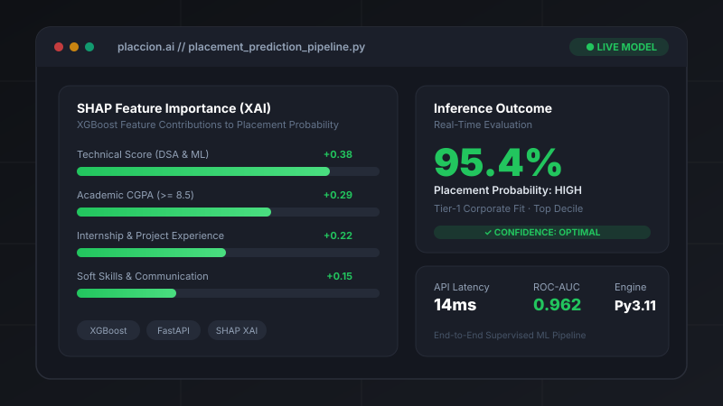

# Mehakmeet Kaur — Portfolio ✦ AI/ML Engineer

> **Personal portfolio of Mehakmeet Kaur** — AI/ML Engineer & Full Stack Developer specializing in Machine Learning, Computer Vision, and Python.

---

## ⚡ Tech Stack

- **Machine Learning & XAI**: Scikit-learn, XGBoost, RAG, LLMs, SHAP, Model Training, Cross-Validation
- **Deep Learning & Computer Vision**: TensorFlow, CNNs, Neural Networks, OpenCV, Image Processing, GLCM, LBP
- **Data & Backend**: FastAPI, Flask, Node.js, REST APIs, Pandas, NumPy, SQL
- **Web & Databases**: React.js, Next.js, TypeScript, PostgreSQL, Supabase, Firebase, MySQL, MongoDB
- **Cloud & Tools**: Docker, Linux, Git, GitHub, Streamlit, Vite

---

## 🚀 Featured Projects

1. **Placcion — AI-Powered Placement Prediction Platform**  
   End-to-end supervised ML pipeline with Scikit-learn, XGBoost, FastAPI, React/Next.js, and SHAP Explainable AI.
2. **DermaSense AI — AI Skin Analysis Platform**  
   Computer vision application utilizing TensorFlow, CNNs, OpenCV, and Firebase for automated facial image analysis and skin condition classification.
3. **CardioAI — Coronary Angiogram Analysis Platform**  
   Coronary blockage detection from angiogram images using GLCM & LBP texture features with a hybrid Random Forest + SVM ensemble model.
4. **SepsisGuard AI — Early Sepsis Risk Prediction (🏆 Hackathon Winner)**  
   Clinical ML pipeline for early sepsis-risk prediction on ICU datasets.
5. **Full-Stack Production Platforms & APIs**  
   Modern full-stack web applications built with React.js, Vite, Supabase Edge Functions, PostgreSQL (RLS), and Razorpay payments.

---

## 📬 Contact & Connect

- **Email**: [mehakmeet1301@gmail.com](mailto:mehakmeet1301@gmail.com)
- **LinkedIn**: [linkedin.com/in/mehak-kaur2513](https://www.linkedin.com/in/mehak-kaur2513/)
- **GitHub**: [github.com/Mehak2513kaur](https://github.com/Mehak2513kaur)
- **Phone**: +91 6239150742

---
*© 2026 Mehakmeet Kaur. Built with clean HTML, CSS, JavaScript, and custom SVG visuals.*
